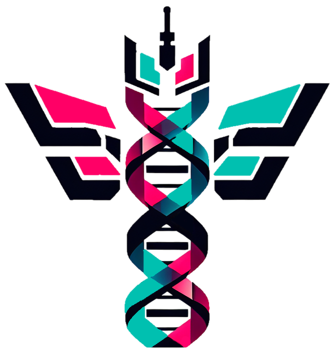
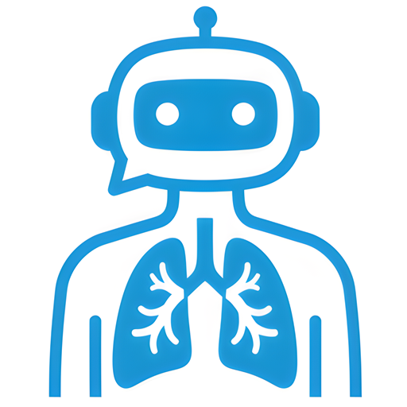
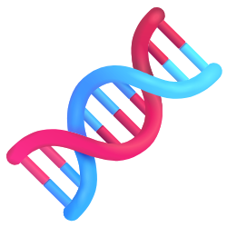

<h1 align="center"> Hello, I'm Adib! 🍁</h1>

  
  
  
  
  

  <strong> 🤖 Machine Learning Engineer &nbsp; | &nbsp; 🧠 Biologist &nbsp; | &nbsp; 🌐 Community Builder</strong>

  Machine Learning at Cohere, Vector Institute and University Health Network, Computer Science and Neuroscience student at the University of Toronto, ambitious to push the boundaries of developing Artificial Intelligence and understanding Biological Intelligence.

---
 

## 🚀 Featured Research

  <table>
    <tr>
      <td width="33%" valign="top">
        

          
        

        <h3 align="center"><strong>CodonTransformer</strong></h3><h4 align="center">Nature Communications</h4>
        

          
          
          
        

        

          Engineered a SOTA model to optimize DNA sequences for protein expreesion in 164 organisms, releasing the largest toolkit for codon optimization.
        

      </td>
      <td width="33%" valign="top">
        

          
        

        <h3 align="center"><strong>MedRAX</strong></h3><h4 align="center">ICML 2025</h4>
        

          
          
          
        

        

          Built the world's most advanced medical reasoning agent for chest x-ray interpretation, outperforming general purpose and medical trained models.
        

      </td>
       <td width="33%" valign="top">
        

          
        

        <h3 align="center"><strong>BioReason</strong></h3><h4 align="center">NeurIPS 2025</h4>
        

          
          
          
        

        

          Created the first reasoning model in biology that would reason on DNA and natural language to predict how a mutation would lead to a disease.
        

      </td>
    </tr>
  </table>

 

## 🛠 Tech Stack

  
  
  
  
  
  
  
  
  
  
  
  
  
  
  
  
  
  
  
  
  

 
